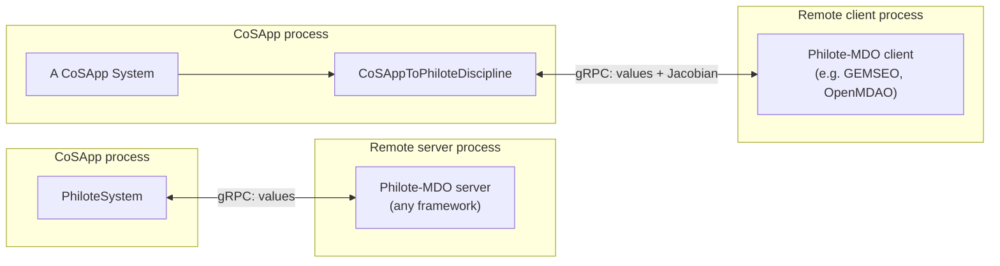

# Using CoSApp with Philote-MDO

## What problem does this solve?

[CoSApp](https://cosapp.readthedocs.io) models a system as a tree of
`System` objects that exchange data through `Port` objects, and solves
them with drivers such as a `NonLinearSolver`. `philote_mdo.cosapp`
connects CoSApp to the Philote-MDO protocol, in **both** directions:

- `PhiloteSystem` is a CoSApp `System` connected to *any* (explicit)
  Philote-MDO server, e.g. a `philote-mdo` discipline, an OpenMDAO model
  served through `philote_mdo.openmdao.OpenMdaoSubProblem`, or a GEMSEO
  discipline served through `philote_mdo.gemseo.GEMSEOtoPhiloteDiscipline`.
- `CoSAppToPhiloteDiscipline` wraps a CoSApp `System` as a Philote-MDO
  explicit discipline, so that it can be served to *any* Philote-MDO
  client, e.g. a GEMSEO `PhiloteDiscipline` or an OpenMDAO
  `RemoteExplicitComponent`.



This page walks through the complete example
[`examples/cosapp_and_gemseo.py`](https://github.com/MDO-Standards/Philote-Python/blob/main/examples/cosapp_and_gemseo.py),
which illustrates both directions.

## Installation

```bash
pip install philote-mdo[cosapp]
```

`philote_mdo.cosapp` is part of `philote-mdo` itself; CoSApp is not a
hard dependency of the package, so it must be installed separately (or via
the `philote-mdo[cosapp]` extra). The example below also uses GEMSEO
(`philote-mdo[cosapp,gemseo]`).

## Serving a CoSApp system to GEMSEO

### The CoSApp system

The system computes the area and the perimeter of a rectangle whose
dimensions are given through a port:

```python
class GeometryPort(Port):
    """The dimensions of a rectangle."""

    def setup(self) -> None:
        """Declare the length and the width."""
        self.add_variable("length", 1.0, unit="m")
        self.add_variable("width", 1.0, unit="m")


class Rectangle(System):
    """The area and the perimeter of a rectangle."""

    def setup(self) -> None:
        """Declare the dimensions, the area and the perimeter."""
        self.add_input(GeometryPort, "geometry")
        self.add_outward("area", 1.0, unit="m**2")
        self.add_outward("perimeter", 4.0, unit="m")

    def compute(self) -> None:
        """Compute the area and the perimeter from the dimensions."""
        length = self.geometry.length
        width = self.geometry.width
        self.area = length * width
        self.perimeter = 2 * (length + width)
```

### Serving it and optimizing it

`CoSAppToPhiloteDiscipline` names the Philote variables after their
CoSApp paths: `"geometry.length"` and `"geometry.width"` for the inputs,
`"area"` and `"perimeter"` for the outwards. By default, every numerical
variable of the input ports (including the inwards) is an input, and every
numerical variable of the output ports (including the outwards) is an
output; use `input_names` and `output_names` to choose them, e.g. to hide
the unknowns of a solver. A scalar CoSApp variable is exposed as a Philote
variable of shape `(1,)`, and the CoSApp units are forwarded to the
clients.

Executing the discipline sets the inputs of the system and calls its
`run_drivers` method, so that the drivers attached to it are run.

:::note
CoSApp does not provide analytic derivatives, so the Jacobian is
approximated by forward finite differences on the server side, with the
relative step `fd_step`: the input component $x_j$ is perturbed by
$h_j = \delta \max(1, |x_j|)$ where $\delta$ is `fd_step`. This costs one
execution of the system per input component. `fd_step=0` disables the
Jacobian.
:::

```python
def optimize_cosapp_system_with_gemseo(port: int) -> None:
    """Serve a CoSApp system and optimize it with GEMSEO.

    Args:
        port: The port of the server.
    """
    server = create_server(port)
    ExplicitServer(
        discipline=CoSAppToPhiloteDiscipline(Rectangle("rectangle"))
    ).attach_to_server(server)
    server.start()
    try:
        # The Philote variables are named after their CoSApp paths,
        # e.g. "geometry.length" and "area".
        rectangle = PhiloteDiscipline(channel=grpc.insecure_channel(f"{HOST}:{port}"))
        design_space = create_design_space()
        design_space.add_variable(
            "geometry.length", lower_bound=0.1, upper_bound=10.0, value=1.0
        )
        design_space.add_variable(
            "geometry.width", lower_bound=0.1, upper_bound=10.0, value=2.0
        )
        scenario = create_scenario(
            [rectangle],
            objective_name="area",
            design_space=design_space,
            maximize_objective=True,
            formulation_settings_model=DisciplinaryOpt_Settings(),
        )
        scenario.add_constraint("perimeter", constraint_type="ineq", value=10.0)
        # The Jacobian is approximated by finite differences on the server side.
        scenario.execute(algo_settings_model=SLSQP_Settings(max_iter=50))
        # The optimum is the square of side 2.5 m.
        print(scenario.optimization_result)  # noqa: T201
    finally:
        # Stop the server explicitly:
        # its worker threads would otherwise keep the process alive.
        server.stop(0)
```

GEMSEO's SLSQP finds the square of side 2.5 m, of area 6.25 m², under the
constraint `perimeter <= 10`.

## Solving a Philote discipline with CoSApp

`PhiloteSystem` queries the server for the variables of the discipline at
setup and declares them as CoSApp variables. By default, the inputs are
gathered in the input port `philote_in` and the outputs in the output port
`philote_out`, so that they can be connected to other systems;
`use_ports=False` declares them as inwards and outwards instead, and
`input_port_name` / `output_port_name` rename the ports. A variable of
shape `(1,)` is exposed as a `float`, and the units are forwarded when
CoSApp knows them (otherwise the variable is dimensionless and a warning
is logged). Discipline options can be sent to the server with `options`.

Here, a CoSApp `NonLinearSolver` finds `x` such that `f_xy(x, 2) = 39`:

```python
def solve_philote_discipline_with_cosapp(port: int) -> None:
    """Serve a Philote discipline and solve it with CoSApp.

    Args:
        port: The port of the server.
    """
    server = create_server(port)
    ExplicitServer(discipline=Paraboloid()).attach_to_server(server)
    server.start()
    try:
        # The Philote inputs and outputs are gathered
        # in the ports "philote_in" and "philote_out".
        paraboloid = PhiloteSystem(
            "paraboloid", channel=grpc.insecure_channel(f"{HOST}:{port}")
        )
        solver = paraboloid.add_driver(NonLinearSolver("solver", tol=1e-10))
        solver.add_unknown("philote_in.x").add_equation("philote_out.f_xy == 39.0")
        paraboloid.philote_in.x = 0.0
        paraboloid.philote_in.y = 2.0
        paraboloid.run_drivers()
        # f_xy(x, 2) = 39 <=> x = 1 or x = 3; the solver converges to x = 1.
        print(f"x = {paraboloid.philote_in.x}")  # noqa: T201
    finally:
        server.stop(0)
```

:::note Variable names
A Philote variable name that is not a valid CoSApp name is sanitized: the
invalid characters are replaced by `_`, and the names that do not start
with a letter or that are reserved by CoSApp, e.g. `t`, are prefixed by
`v_`. For instance, a CoSApp system served by `CoSAppToPhiloteDiscipline`
and used through a `PhiloteSystem` exposes `p_in.x` as
`philote_in.p_in_x`. The mapping from the Philote names to the CoSApp
paths is available in `PhiloteSystem.variable_paths`.
:::

Only the continuous variables are supported by the CoSApp wrappers.
